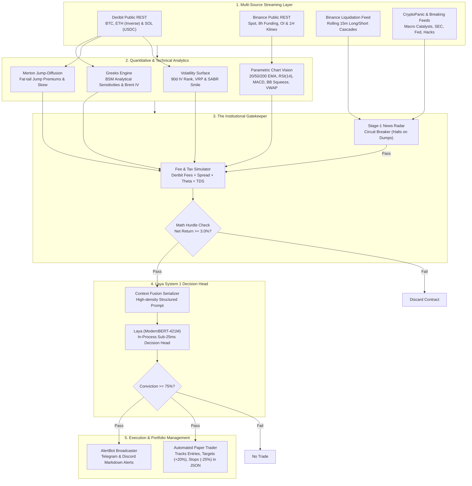

# RedAgent: Institutional-Grade AI Crypto Options Decision Engine

[](https://www.python.org/downloads/)
[]()
[](https://huggingface.co/convaiinnovations/laya)
[]()
[]()
[]()

**RedAgent** is an institutional-grade, AI-driven crypto Call options decision and advisory engine built for **Bitcoin (BTC)**, **Ethereum (ETH)**, and **Solana (SOL)** derivatives. 

Powered by **ConvAI Innovations' Laya** (`convaiinnovations/laya`)—an open-weight, non-autoregressive System 1 decision model fine-tuned on top of **ModernBERT-421M**—RedAgent rejects the high latency (1–3s), non-determinism, and hallucinations of conversational LLMs. Instead, it operates in a **single encoder forward pass (<25ms)**, outputting typed, deterministic classifications over an institutional quantitative state.


---

## 1. The Core Philosophy: "Math Before Model"

Most retail crypto options traders lose money even when their directional thesis is correct because **derivatives friction destroys their gains**:
1. **Deribit Exchange Taker Fees:** $0.03\%$ of underlying spot price (capped at $12.5\%$ of option premium).
2. **Bid-Ask Spread Drag:** Half-spread crossing costs $\frac{\text{Ask} - \text{Bid}}{2}$ on wide crypto books.
3. **Calendar Theta Decay ($\Theta$):** Unforgiving daily erosion of extrinsic time value.
4. **Regulatory Friction (e.g. Indian Section 115BBH / 194S TDS):** $31.2\%$ flat tax with zero loss offset, plus $1\%$ TDS per transaction.

RedAgent mathematically enforces the **Net Hurdle Rule**:

$$\text{Projected Net Return} = \frac{\Delta \text{Option Value} - \text{RoundTripFees} - \text{ThetaDecay} - \text{SpreadCost}}{\text{Ask Entry Premium}} \ge 3.0\%$$

If a setup cannot mathematically achieve $\ge 3.0\%$ net profit after all frictional drag, it is **discarded immediately** before reaching the neural inference head, protecting capital from negative-EV trades.

---

## 2. Product Architecture & System Design



---

## 3. Deep Dive: Architectural Subsystems

### Subsystem A: Multi-Asset Options & Market Data (`src/data/`)
* **Deribit Multi-Asset Engine ([`src/data/deribit_client.py`](file:///Users/prakharsatyam/codes/redagent/src/data/deribit_client.py)):** Supports coin-margined inverse contracts (**BTC**, **ETH**) and linear USDC-settled contracts (**SOL** under `currency=USDC`). Automatically converts quotation currencies into normalized dollar units.
* **Binance Context Client ([`src/data/binance_client.py`](file:///Users/prakharsatyam/codes/redagent/src/data/binance_client.py)):** Streams spot prices, 8-hour perpetual funding rates (detecting crowded longs/shorts), open interest, and historical 1H OHLCV candlestick klines.
* **Liquidation Cascade Radar ([`src/data/liquidation_feed.py`](file:///Users/prakharsatyam/codes/redagent/src/data/liquidation_feed.py)):** Tracks rolling 15-minute long vs short liquidations to detect cascading waterfalls or short squeezes.

### Subsystem B: Quantitative Math & Parametric Chart Vision (`src/quant/`)
* **Analytical Greeks & IV ([`src/quant/greeks.py`](file:///Users/prakharsatyam/codes/redagent/src/quant/greeks.py)):** Computes exact closed-form Black-Scholes Greeks ($\Delta, \Gamma, \Theta, \nu, \rho$) and solves for Implied Volatility using Brent's root-finding method.
* **Merton Jump-Diffusion ([`src/quant/merton_jump.py`](file:///Users/prakharsatyam/codes/redagent/src/quant/merton_jump.py)):** Quantifies non-Gaussian fat tails and Poisson jump arrival intensity ($\lambda$) with Corrado-Su skewness/kurtosis adjustments.
* **Parametric Chart Indicators ([`src/quant/technical_indicators.py`](file:///Users/prakharsatyam/codes/redagent/src/quant/technical_indicators.py)):** Converts raw OHLCV candlesticks into high-density quantitative tokens:
  - **Trend:** Exponential Moving Averages (20 EMA, 50 EMA, 200 SMA).
  - **Momentum:** RSI(14) with Wilder smoothing; MACD (12, 26, 9) histogram & signal bias.
  - **Volatility Squeeze:** Bollinger Bands (20, 2.0 std dev) with bandwidth compression detection.
  - **Key Structure:** Rolling 24-hour Support / Resistance levels and Volume Weighted Average Price (VWAP).

### Subsystem C: 2-Stage ModernBERT AI Architecture (`src/model/`)
* **Stage 1 — Protective News Radar ([`src/model/laya_news_engine.py`](file:///Users/prakharsatyam/codes/redagent/src/model/laya_news_engine.py)):** Evaluates breaking news headlines in sub-15ms. If a market dump catalyst (exploit, regulatory enforcement, liquidation cascade) is detected with $\ge 70\%$ confidence, it triggers an **automated circuit breaker** that halts all Call option evaluation.
* **Context Fusion Serializer ([`src/model/state_serializer.py`](file:///Users/prakharsatyam/codes/redagent/src/model/state_serializer.py)):** Fuses quantitative Greeks, technical indicators, news sentiment, and fee payoffs into a dense, typed state document.
* **Stage 2 — Laya Options Decision Head ([`src/model/laya_engine.py`](file:///Users/prakharsatyam/codes/redagent/src/model/laya_engine.py)):** ModernBERT-421M non-autoregressive encoder delivers calibrated win probability $P(\text{gain} \ge 3\%)$ in sub-25ms. Triggers buy recommendations only when conviction is $\ge 75\%$.

### Subsystem D: Execution & Paper Portfolio Tracking (`src/signals/`)
* **Alert Broadcaster ([`src/signals/alert_bot.py`](file:///Users/prakharsatyam/codes/redagent/src/signals/alert_bot.py)):** Dispatches actionable trade alerts with spot, strike, DTE, Greeks, Target Exit ($+20\%$), Stop Loss ($-25\%$), and Laya conviction scores via Telegram/Discord.
* **Virtual Paper Portfolio ([`src/signals/paper_trader.py`](file:///Users/prakharsatyam/codes/redagent/src/signals/paper_trader.py)):** Simulates live execution, tracks open positions, monitors live bids against targets and stop losses every 60 seconds, and persists realized PnL and fee statistics to [`data/paper_portfolio.json`](file:///Users/prakharsatyam/codes/redagent/data/paper_portfolio.json).
* **Master Scanner Orchestrator ([`src/signals/signal_engine.py`](file:///Users/prakharsatyam/codes/redagent/src/signals/signal_engine.py)):** Runs continuous live market scanning across BTC, ETH, and SOL.

---

## 4. Multi-Asset Deribit Derivatives Matrix

| Asset | Contract Type | Deribit Code | Settlement | Quotation Model |
| :--- | :--- | :--- | :--- | :--- |
| **Bitcoin (BTC)** | Inverse (Coin-Margined) | `currency=BTC` | BTC | Quoted in BTC ($\text{USD} = \text{Quote} \times \text{Spot}$) |
| **Ethereum (ETH)** | Inverse (Coin-Margined) | `currency=ETH` | ETH | Quoted in ETH ($\text{USD} = \text{Quote} \times \text{Spot}$) |
| **Solana (SOL)** | Linear (Cash-Settled) | `currency=USDC` | USDC | Quoted directly in USD/USDC ($\text{USD} = \text{Quote}$) |

---

## 5. Repository Structure

```
redagent/
├── config/
│   ├── settings.py                 # Central configuration, hurdles & credential loader
│   └── fees.py                     # Deribit fee schedule & Indian Section 115BBH/194S model
├── src/
│   ├── data/
│   │   ├── deribit_client.py       # Deribit options matrices (BTC, ETH, SOL)
│   │   ├── binance_client.py       # Spot price, 8h funding, OI & 1H candlestick klines
│   │   ├── news_streamer.py        # CryptoPanic & breaking crypto RSS headlines
│   │   ├── liquidation_feed.py     # Rolling 15-minute long/short liquidation radar
│   │   └── data_pipeline.py        # Synchronized multi-source market snapshot
│   ├── quant/
│   │   ├── greeks.py               # BSM analytical Greeks & Brent's IV root solver
│   │   ├── merton_jump.py          # Merton (1976) Jump-Diffusion & Corrado-Su skewness
│   │   ├── volatility_surface.py   # 90-day IV Rank, VRP, and SABR volatility smile
│   │   ├── technical_indicators.py # 20/50/200 EMA, RSI(14), MACD, BB squeeze & VWAP
│   │   ├── fee_simulator.py        # Gatekeeper enforcing >= 3.0% net return hurdle
│   │   └── pattern_discovery.py    # AI symbolic formula & feature rule discovery
│   ├── model/
│   │   ├── state_serializer.py     # Context fusion & high-density prompt builder
│   │   ├── laya_news_engine.py     # Stage-1 protective radar & circuit breaker
│   │   ├── laya_engine.py          # Stage-2 in-process Laya decision head
│   │   └── dataset_generator.py    # Walk-forward dataset generator & hard negative miner
│   └── signals/
│       ├── signal_engine.py        # Master real-time scanner loop (BTC/ETH/SOL)
│       ├── alert_bot.py            # Telegram & Discord markdown signal broadcaster
│       └── paper_trader.py         # Virtual portfolio manager & JSON ledger
├── scripts/
│   ├── fetch_historical_options.py # Multi-asset options tick generator (3,000+ samples)
│   ├── fetch_historical_news.py    # Historical crypto headlines fetcher
│   ├── label_news_dataset.py       # 15m forward event-study news labeling engine
│   └── sync_colab.py               # Two-way Mac <-> Google Drive / Colab sync bridge
├── tests/                          # 74 automated pytest unit tests (100% passing)
├── laya.ipynb                      # Colab GPU notebook: Stage-2 Options Head fine-tuning
├── laya_news.ipynb                 # Colab GPU notebook: Stage-1 News Head fine-tuning
├── LIVE_OPERATIONS_MANUAL.md       # Complete production deployment & runbook guide
├── pyproject.toml                  # Project metadata & dependencies
└── keys.env.example                # Sanitized credential template
```

---

## 6. Quickstart & Operational Commands

### 6.1 Run the Full Test Suite
```bash
source .venv/bin/activate
pytest tests/ -q
# Output: 74 passed in ~2.5s
```

### 6.2 Single-Pass Live Market Dry Run
Inspect live options chains, analytical Greeks, technical indicators, and hurdle evaluations:
```bash
# Evaluate live Bitcoin Call options:
.venv/bin/python src/signals/signal_engine.py --currency BTC --iterations 1

# Evaluate live Solana Call options:
.venv/bin/python src/signals/signal_engine.py --currency SOL --iterations 1

# Evaluate live Ethereum Call options:
.venv/bin/python src/signals/signal_engine.py --currency ETH --iterations 1
```

### 6.3 Generate 3,000+ Historical Ticks for Model Training
```bash
# Generate 3,000 ticks across BTC, ETH, and SOL:
.venv/bin/python scripts/fetch_historical_options.py --currency ALL --samples 3000

# Convert raw parquet into walk-forward JSONL training sets with hard negative mining:
.venv/bin/python src/model/dataset_generator.py \
  --input_parquet data/raw/deribit_btc.parquet \
  --train_out data/processed/train.jsonl \
  --val_out data/processed/val.jsonl
```

### 6.4 Launch the Continuous Live Scanner Daemon
Runs automated scanning, hurdle enforcement, and virtual paper trading every 60 seconds:
```bash
# Run in background with logging:
nohup .venv/bin/python src/signals/signal_engine.py --currency BTC --interval 60 --iterations 0 > scanner_btc.log 2>&1 &
echo $! > scanner_btc.pid

# Monitor live scanner:
tail -f scanner_btc.log
```

---

## 7. Operations Manual & Production Guide

For complete instructions on configuring Telegram alerts, fine-tuning Laya in Google Colab, and inspecting paper portfolio returns, refer to:
👉 **[`LIVE_OPERATIONS_MANUAL.md`](file:///Users/prakharsatyam/codes/redagent/LIVE_OPERATIONS_MANUAL.md)**

---

## 8. License & Disclaimer

RedAgent is intended for quantitative research, advisory signal generation, and simulated paper execution. Derivatives trading carries substantial risk of loss. Always manage risk responsibly.
