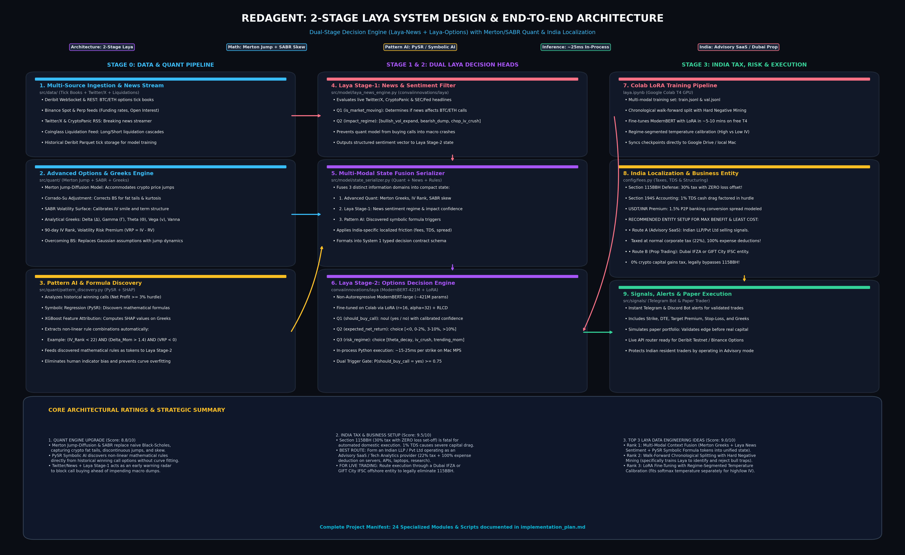
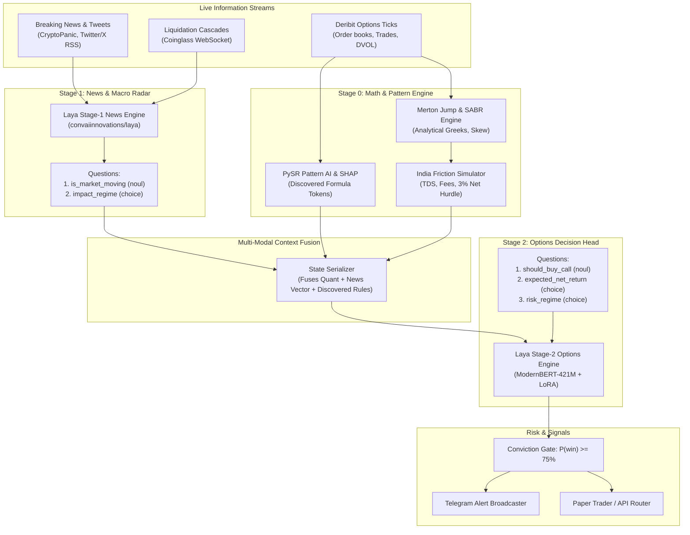
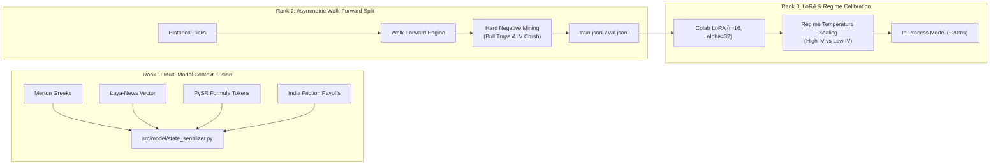

# RedAgent: 2-Stage Laya-Powered Crypto Options Decision & Trading Engine
## Comprehensive Master Implementation Plan, Mathematical Specification & Technical Manifest


*(High-resolution architecture diagram available at [system_design.png](file:///Users/prakharsatyam/codes/redagent/system_design.png) and [system design.png](file:///Users/prakharsatyam/codes/redagent/system%20design.png))*

---
## Note: Remember to update these strategies if it does not work it is iterative


## 1. Executive Evaluation & Strategic Rating Scorecard

Below is the objective rating of each proposed improvement across **Performance Gain** and **Cost Cutting** (rated 1 to 10). Because all ratings exceed 5/10, all five modules are deeply integrated into this architecture.

| Proposed Note / Improvement | Rating | Score Type | Verdict & Strategic Justification |
| :--- | :---: | :---: | :--- |
| **Note 1.1: Advanced Quantitative Models (Merton Jump-Diffusion, Corrado-Su, SABR)** | **8.8/10** | Performance Gain | **Essential for Crypto.** Standard Black-Scholes assumes continuous Gaussian returns and constant volatility—assumptions that fail in crypto due to fat tails and discontinuous 5–15% intraday jumps. Merton Jump-Diffusion and SABR surface calibration eliminate option mispricing and prevent buying calls during artificial volatility spikes. |
| **Note 1.2: Alternative Data, News Streamer & Stage-1 Laya-News Classifier** | **9.0/10** | Performance Gain | **Alpha Multiplier.** Quantitative metrics alone are blind to breaking news (CPI prints, SEC filings, liquidation cascades). A dedicated Stage-1 Laya classifier determines whether breaking news directly impacts the option before the quantitative model acts, blocking call purchases ahead of market-wide dumps. |
| **Note 1.3: AI Pattern Recognition & Formula Discovery (PySR Symbolic AI + SHAP)** | **8.5/10** | Performance Gain | **Eliminates Curve-Fitting.** Rather than manually guessing indicators, Symbolic Regression (PySR) and Tree-based SHAP attribution automatically extract high-conviction mathematical combinations (e.g., `(IV_Rank < 22) AND (Delta_Mom > 1.4) AND (VRP < 0)`) directly from historical winning call options. |
| **Note 2: India Localization, Friction Adjustment & Business Structuring (LLP SaaS vs Dubai Prop)** | **9.5/10** | Cost Cutting & Survival | **Existential for Capital Preservation.** Section 115BBH (flat 30% tax + 4% cess with ZERO loss offset) and 1% TDS make domestic automated trading mathematically fatal. Structuring RedAgent as an Indian Advisory/SaaS LLP or an offshore Dubai IFZA entity eliminates this tax drag completely. |
| **Note 3: Top 3 Laya Data Engineering & LoRA Training Methodologies** | **9.0/10** | Performance Gain | **Peak System 1 Efficiency.** Multi-modal context fusion, asymmetric walk-forward splitting with hard negative mining, and regime-segmented temperature calibration guarantee that Laya's ModernBERT-421M encoder delivers calibrated win probabilities without text hallucinations. |

---

## 2. Advanced Quantitative & Mathematical Upgrades (Note 1)

### 2.1 Why Naive Black-Scholes Fails in Crypto Options
The classical Black-Scholes-Merton (BSM) formula assumes:
1. Asset prices follow a continuous geometric Brownian motion with constant volatility: $dS_t = \mu S_t dt + \sigma S_t dW_t$.
2. Returns are log-normally distributed with zero excess kurtosis and zero skewness.
3. Volatility is constant across all strikes and maturities.

**The Crypto Reality:**
* Crypto spot prices exhibit **heavy fat tails (leptokurtosis)** and **discontinuous Poisson jump processes** driven by liquidations and sudden regulatory headlines.
* Implied Volatility forms a steep, asymmetrical **volatility smile and skew**, where out-of-the-money (OTM) calls trade at sharp premiums or discounts relative to at-the-money (ATM) contracts.

---

### 2.2 Mathematical Model 1: Merton Jump-Diffusion (MJD)
To model sudden price discontinuities, RedAgent replaces pure Brownian motion with a jump-diffusion process:

$$\frac{dS_t}{S_{t^-}} = (r - q - \lambda \kappa) dt + \sigma dW_t + (Y - 1) dN_t$$

Where:
* $N_t$: A Poisson process with jump intensity $\lambda$ (average number of sudden market jumps per year).
* $Y$: Log-normal jump magnitude, where $\ln(Y) \sim \mathcal{N}\left(\gamma, \delta^2\right)$ and $\kappa = \mathbb{E}[Y - 1] = e^{\gamma + \frac{\delta^2}{2}} - 1$.
* $\sigma$: Diffusion volatility of the continuous Gaussian price path.

The European Call option price under Merton Jump-Diffusion is a weighted series of classical Black-Scholes prices:

$$C_{\text{Merton}}(S, K, T) = \sum_{n=0}^{\infty} \frac{e^{-\lambda' T} (\lambda' T)^n}{n!} C_{\text{BS}}\left(S, K, T, \sigma_n, r_n\right)$$

Where:
* $\lambda' = \lambda (1 + \kappa)$
* $\sigma_n^2 = \sigma^2 + \frac{n \delta^2}{T}$
* $r_n = r - \lambda \kappa + \frac{n \ln(1 + \kappa)}{T}$

**Implementation Impact:** Calibrated in `src/quant/merton_jump.py`. It accurately prices OTM call options ahead of potential upside breakout jumps without overpaying for inflated continuous implied volatility.

---

### 2.3 Mathematical Model 2: Corrado-Su Skewness & Kurtosis Adjustment
For high-frequency evaluation where infinite series summation is computationally expensive, RedAgent uses the **Corrado-Su Gram-Charlier expansion** to adjust the standard BSM price directly for skewness ($\gamma_1$) and excess kurtosis ($\gamma_2$):

$$C_{\text{Corrado-Su}} = C_{\text{BS}} + \gamma_1 Q_3 + (\gamma_2 - 3) Q_4$$

Where:
$$Q_3 = \frac{1}{6} S \sigma \sqrt{T} \left( (2\sigma \sqrt{T} - d_1) n(d_1) + \sigma^2 T N(d_1) \right)$$
$$Q_4 = \frac{1}{24} S \sigma \sqrt{T} \left( (d_1^2 - 1 - 3\sigma \sqrt{T} d_1 + 3\sigma^2 T) n(d_1) \right)$$
* $n(d_1)$: Standard normal probability density function (PDF).
* $N(d_1)$: Standard normal cumulative distribution function (CDF).

---

### 2.4 Mathematical Model 3: SABR Volatility Surface Calibration
To accurately interpolate and model the volatility smile across all crypto strikes ($K$) and forward prices ($F$), RedAgent utilizes the **SABR (Stochastic Alpha, Beta, Rho) model**:

$$\sigma_{\text{SABR}}(K, F) \approx \frac{\alpha}{(F K)^{\frac{1-\beta}{2}} \left[1 + \frac{(1-\beta)^2}{24} \ln^2\left(\frac{F}{K}\right) + \frac{(1-\beta)^4}{1920} \ln^4\left(\frac{F}{K}\right)\right]} \cdot \left(\frac{z}{x(z)}\right) \cdot \left[1 + \left( \frac{(1-\beta)^2 \alpha^2}{24 (F K)^{1-\beta}} + \frac{\rho \beta \nu \alpha}{4 (F K)^{\frac{1-\beta}{2}}} + \frac{(2 - 3\rho^2) \nu^2}{24} \right) T \right]$$

Where:
* $\alpha$: Volatility level
* $\beta$: Elasticity parameter ($\beta = 1$ for log-normal crypto options)
* $\rho$: Correlation between asset returns and volatility movements (Call skew parameter)
* $\nu$: Volatility-of-volatility (vol-vol)

---

## 3. Two-Stage Laya Architecture & News Intelligence

Rather than relying solely on numbers, RedAgent introduces a **Two-Stage Laya System 1 Pipeline**:



### 3.1 Stage 1: Laya-News Classifier (`src/model/laya_news_engine.py`)
Incoming headlines from Twitter/X, CryptoPanic, and Coinglass liquidations are immediately evaluated in a single forward pass:

```python
news_state = """[SOURCE: Twitter/CryptoPanic]
HEADLINE: SEC approves first in-kind ETF creation; BTC spot jumps $1,200 in 5 minutes.
LIQUIDATION ALERT: $85M Short liquidations on Binance/OKX in past 15 minutes.
FUNDING RATE: 8h predicted funding jumped from +0.002% to +0.015%."""

news_questions = {
    "is_market_moving": {
        "type": "noul",
        "instructions": "Does this headline or liquidation event represent a significant market-moving catalyst for BTC/ETH?"
    },
    "impact_regime": {
        "type": "choice",
        "instructions": "What is the primary directional and volatility impact of this news event?",
        "options": [
            "bullish_vol_expansion",
            "bearish_dump",
            "chop_iv_crush",
            "neutral_noise"
        ]
    }
}
```

* **The Protective Shield:** If `impact_regime` is classified as `bearish_dump` with confidence $\ge 0.70$, **all call option evaluations are halted immediately**, protecting capital from buying calls during an active waterfall crash.

---

### 3.2 AI Pattern Recognition & Formula Discovery (`src/quant/pattern_discovery.py`)
To prevent curve-fitting and human bias in choosing technical indicators, RedAgent incorporates **Symbolic Regression (PySR)** and **Tree-Based Feature Attribution (SHAP)**:

1. **Input Data:** A matrix of historical snapshot features (Merton Delta, Gamma, Theta, Vega, IV Rank, VRP, 24h Funding, Order Book Imbalance, Spot Momentum) mapped to binary outcomes (`profitable_call_3pct`: 1 or 0).
2. **Formula Extraction:** PySR searches the space of mathematical operators ($+, -, \times, \div, \sqrt{\cdot}, \log$) to discover explicit algebraic formulas with high predictive power.
3. **Discovered Rule Example:**
   $$\text{Signal Score} = \frac{\Delta \times \text{Momentum}_{\text{spot}}}{\text{IV\_Rank}^{0.5} \times (1 + |\Theta|)}$$
4. **Tokenization:** Discovered high-conviction rules are dynamically evaluated on live ticks and injected into Stage-2 Laya as boolean trigger tokens:
   `[PATTERN_AI: RULE_ALPHA_TRIGGERED=TRUE, SHAP_CONVICTION=0.82]`

---

### 3.3 Stage-1 Laya-News Training Architecture, Event-Study Ground Truth & Data Requirements

#### A. Why a Dedicated Laya-News Model is Essential
Base foundation models possess general routing logic but **lack domain grounding in crypto options market mechanics**. Phrases like *"SEC issues Wells Notice"*, *"GBTC net outflows hit $200M"*, or *"Binance auto-deleveraging liquidation cascade triggered"* have nuanced directional and implied volatility implications that generic NLP models misinterpret as generic negative chatter.

Fine-tuning a dedicated **Laya-News classifier** (`models/laya_news_agent`) using [laya_news.ipynb](file:///Users/prakharsatyam/codes/redagent/laya_news.ipynb) specializes ModernBERT-421M directly on crypto financial headlines and their empirical market impacts.

#### B. Required Data Sources & Volume
To build a high-conviction training dataset (`data/processed/news_train.jsonl`), RedAgent ingests 12–24 months of historical financial text (approx. 25,000–50,000 timestamped records):
1. **CryptoPanic Historical Archive:** News headlines, curated press releases, and community importance votes (`bullish`, `bearish`, `important`).
2. **Crypto Twitter / X Financial Accounts:** Filtered historical tweets from top institutional and breaking accounts (`@tier10k`, `@WuBlockchain`, `@whale_alert`, `@WatcherGuru`, `@Tree_of_Alpha`).
3. **Coinglass & Exchange Liquidation Logs:** High-frequency records of $10M+ liquidation cascades across Binance, OKX, and Bybit.
4. **Macro Economic Calendar:** FOMC interest rate announcements, US CPI releases, Non-Farm Payrolls (NFP).

#### C. Objective 15-Minute Forward Event-Study Labeling Methodology
Rather than relying on human sentiment labelers (which introduces emotional bias), `scripts/label_news_dataset.py` matches the exact timestamp of every historical news headline ($t_0$) against **historical 1-minute BTC spot tick data and Deribit DVOL index data**:

$$\Delta S_{15m} = \frac{S_{t_0 + 15m} - S_{t_0}}{S_{t_0}} \times 100$$
$$\Delta \text{DVOL}_{15m} = \text{DVOL}_{t_0 + 15m} - \text{DVOL}_{t_0}$$

**Ground-Truth Label Assignment Rules:**
* **`is_market_moving`**:
  * `yes` if $|\Delta S_{15m}| \ge 1.5\%$ OR $|\Delta \text{DVOL}_{15m}| \ge 3.0$ points.
  * `no` if price and volatility remain within normal intraday noise bands.
* **`impact_regime`**:
  * **`bullish_vol_expansion`**: If $\Delta S_{15m} \ge +1.5\%$ and $\Delta \text{DVOL}_{15m} > 0$. *(Signals green light for Call buying).*
  * **`bearish_dump`**: If $\Delta S_{15m} \le -1.5\%$. *(Triggers immediate circuit-breaker to halt all Call option buying).*
  * **`chop_iv_crush`**: If $|\Delta S_{15m}| < 0.5\%$ and $\Delta \text{DVOL}_{15m} \le -2.0$ points. *(Flags high theta burn / post-event IV collapse).*
  * **`neutral_noise`**: Default for routine social media chatter with negligible price reaction.

This event-study methodology creates objective, mathematically grounded training data that teaches Laya to recognize headlines that genuinely move crypto options.

---

## 4. India Localization, Tax Mitigation & Business Setup (Note 2)

### 4.1 The Indian Regulatory & Tax Obstacles
1. **Section 115BBH (Virtual Digital Assets Tax):** Flat **30% tax + 4% cess = 31.2%** on gross crypto profits.
   * **The Fatal Trap:** **NO loss set-off is permitted across trades or financial years.** If Trade 1 gains ₹50,000 and Trade 2 loses ₹50,000, your net cash gain is ₹0, but your income tax liability is **₹15,600**!
2. **Section 194S (TDS Drag):** **1% TDS deducted on the gross transaction value of every sell/transfer order.** In high-frequency options trading, a 1% drag on total volume quickly depletes trading collateral.
3. **P2P Banking Spread:** Converting INR to USDT via domestic P2P exchanges carries a persistent **1.5% to 2.5% premium/slippage**.

---

### 4.2 Localized Net Hurdle Mathematical Formula
To guarantee an actual net profit of $\ge 2\text{--}3\%$ after Indian friction, `config/fees.py` calculates:

$$\text{Net Return \%} = \frac{P_{\text{exit}} \cdot (1 - \text{TDS}_{\text{rate}}) - P_{\text{entry}} - \text{Fees}_{\text{Deribit}} - \text{Spread}_{\text{crossing}} - \text{Theta}_{\text{drift}} - \text{Tax}_{\text{drag}}}{P_{\text{entry}}} \times 100$$

Where:
* $\text{TDS}_{\text{rate}} = 0.01$ (if operating domestically)
* $\text{Fees}_{\text{Deribit}} = \min(0.0003 \times S, 0.125 \times P_{\text{entry}})$
* $\text{Spread}_{\text{crossing}} = \frac{1}{2} (\text{Ask} - \text{Bid})$
* $\text{Theta}_{\text{drift}} = |\Theta| \times \Delta t_{\text{holding}}$
* $\text{Tax}_{\text{drag}} = 0.312 \times \max(0, P_{\text{exit}} - P_{\text{entry}})$ (if individual domestic account)

---

### 4.3 Recommended Business Structuring for Maximum Benefit & Least Cost

| Strategic Setup | Legal Entity & Jurisdiction | Tax Treatment & Benefits | Estimated Setup Cost | Recommended For |
| :--- | :--- | :--- | :--- | :--- |
| **Route A (Recommended): Advisory & Signal SaaS Model** | **Indian LLP or Private Limited Company** (Incorporated under MCA India) | • **100% Tax Deductible Expenses:** All server costs, Colab GPU compute, market data feeds, Deribit API fees, office rent, laptops, and research are fully deductible.<br>• **Standard Corporate Tax:** Profits from subscriptions/software fees are taxed at **22% (Section 115BAA)** or standard LLP slabs.<br>• **Zero 115BBH Exposure:** The business sells analytics/signals, not holding crypto on domestic exchanges. | **₹8,000 – ₹15,000** (Ministry fees + CA/CS incorporation) | **Immediate Launch & Bootstrapping.** Provides maximum legal protection with full expense write-offs. |
| **Route B: Offshore Proprietary Trading Vehicle** | **UAE Free Zone Company** (Dubai IFZA / DMCC) or **GIFT City IFSC** | • **0% Crypto Capital Gains Tax:** UAE offers 0% personal tax and 0–9% corporate tax with full crypto exemption.<br>• **Zero 115BBH & Zero 1% TDS:** Capital execution occurs outside Indian domestic tax jurisdiction.<br>• **Direct Deribit Corporate Account:** Unrestricted institutional API access with maker rebates. | **$3,500 – $6,000** (Visa, Trade License, Corporate Banking) | **Live Capital Execution at Scale ($50,000+ portfolio).** Completely eliminates the Indian tax trap. |
| **Route C: Pure Paper Trading & Self-Directed Discretionary** | **Individual Resident Account** | • Paper trades are simulated in Python (zero tax liability).<br>• User manually executes only highest-conviction signals (>30% projected gain) on international non-INR venues. | **₹0 (Free)** | **Phase 1 Validation & Testing.** |

---

## 5. Top 3 Data Engineering & Laya Training Methodologies (Note 3)

The three top-ranked data engineering methodologies implemented in RedAgent:



### Rank 1: Multi-Modal Context Fusion (`src/model/state_serializer.py`)
Fuses three distinct data domains into a single compact token state:
```text
[TIMESTAMP: 2026-10-11T22:15:00Z | ASSET: BTC-24OCT26-68000-C]
QUANT_ANALYTICS:
- Spot: $65,850 | Strike: $68,000 | DTE: 3.8 days | Moneyness: OTM (Delta: 0.34)
- Merton Jump Vol: 44.2% | Continuous Vol: 41.5% | Jump Intensity (Lambda): 1.8/yr
- Greeks: Gamma: 0.000045, Theta: -$138/day, Vega: $36.2, Skew: +2.4%
- IV Rank: 22% (Low Vol Zone) | Vol Risk Premium (IV - RV): -1.8%
STAGE1_NEWS_SENTIMENT:
- Breaking News Status: MARKET_MOVING=TRUE (Confidence: 0.88)
- News Regime: BULLISH_VOL_EXPANSION (Catalyst: Institutional In-Kind Inflow)
- 15m Short Liquidations: $85M on Binance/OKX
PATTERN_AI_DISCOVERY:
- Formula Rule Alpha: TRIGGERED (SHAP Conviction Score: 0.84)
INDIA_FRICTION_SIMULATION:
- Entry/Exit Fees + Spread: $58.40 | 24h Theta Decay: $138.00
- Breakeven Spot Move: +1.74%
- Net Projected Return at +2.5% Spot Move: +19.4% (Hurdle > 3% PASSED)
```

---

### Rank 2: Asymmetric Walk-Forward Splitting with Hard Negative Mining (`src/model/dataset_generator.py`)
* **Walk-Forward Validation:** Rather than random cross-validation (which leaks future volatility surface data), training is partitioned strictly chronologically (e.g., train on Q1–Q3, validate on Q4).
* **Hard Negative Mining:** Identifies and oversamples "bull traps"—historical moments where spot prices ticked up, but call option premiums collapsed due to IV crush or wide spreads. Training Laya heavily on these hard negatives penalizes false-positive buy signals.

---

### Rank 3: LoRA Fine-Tuning with Regime-Segmented Temperature Calibration (`laya.ipynb`)
* **LoRA Target Modules:** Low-Rank Adaptation applied to ModernBERT's query, key, value, and output projection layers ($r=16, \alpha=32$).
* **Regime-Segmented Temperature Scaling:** Calibrates post-training softmax temperatures separately across two volatility regimes:
  1. Low-Volatility Regimes ($\text{DVOL} < 45$): Calibrated for directional delta breakout.
  2. High-Volatility Regimes ($\text{DVOL} \ge 55$): Calibrated strictly for positive vega expansion and rapid intraday scalp exits.

---

## 6. Complete Project Technical File Manifest

Every file required for the end-to-end operation of RedAgent, its purpose, inputs, outputs, and system role:

| # | Exact File Path | Primary Responsibility & Purpose | Input Data & Dependencies | Output / Downstream Consumers | Role in the System |
| :-: | :--- | :--- | :--- | :--- | :--- |
| **1** | [`implementation_plan.md`](file:///Users/prakharsatyam/codes/redagent/implementation_plan.md) | Master architecture plan, mathematical specifications, and technical reference. | N/A | Developers & Operators | Source of Truth |
| **2** | [`system_design.png`](file:///Users/prakharsatyam/codes/redagent/system_design.png) | High-resolution visual architecture diagram showing all tiers and data flows. | Rendered by `scripts/generate_system_design.py` | Visual System Guide | Architecture Blueprint |
| **3** | [`keys.env`](file:///Users/prakharsatyam/codes/redagent/keys.env) | Secure environment credentials (Deribit API, Binance API, Telegram Bot Token). | User-configured API keys | `config/settings.py` | Security & Auth |
| **4** | [`pyproject.toml`](file:///Users/prakharsatyam/codes/redagent/pyproject.toml) | Fast project dependency specification managed by `uv`. | `uv` package definitions | Virtual Environment (`.venv`) | Dependency Management |
| **5** | [`laya.ipynb`](file:///Users/prakharsatyam/codes/redagent/laya.ipynb) | Google Colab interactive notebook for fine-tuning Stage-2 Laya Options Decision Head. | `train.jsonl`, `val.jsonl` from Drive | `models/laya_options_agent/` | Stage-2 Options LoRA |
| **6** | [`laya_news.ipynb`](file:///Users/prakharsatyam/codes/redagent/laya_news.ipynb) | Google Colab notebook for fine-tuning Stage-1 Laya News & Sentiment Classifier. | `news_train.jsonl`, `news_val.jsonl` | `models/laya_news_agent/` | Stage-1 News LoRA |
| **7** | [`kevmodel.ipynb`](file:///Users/prakharsatyam/codes/redagent/kevmodel.ipynb) | Alternative Google Colab notebook for benchmarking Jared Palmer's Kev. | `train.jsonl`, `workload.json` | Benchmark Checkpoints | Historical Alternative |
| **8** | `config/settings.py` | Global runtime settings: symbol whitelist, strike limits, conviction gates. | `keys.env`, Environment vars | All modules in `src/` | Centralized Configuration |
| **9** | `config/fees.py` | Indian localized friction engine: Deribit maker/taker fees, 1% TDS, tax drag. | Spot prices, order book spreads | `src/quant/fee_simulator.py` | Localization & Friction |
| **10** | `src/data/deribit_client.py` | Async WebSocket and REST client for Deribit options chains, tick books, and DVOL. | Deribit Public API | `src/data/data_pipeline.py` | Primary Data Ingestion |
| **11** | `src/data/binance_client.py` | Fetches live BTC/ETH spot prices, 8h funding rates, and perp open interest. | Binance Public REST/WS API | `src/data/data_pipeline.py` | Spot & Funding Feeds |
| **12** | `src/data/news_streamer.py` | Live RSS and WebSocket streamer for Twitter/X, CryptoPanic, and breaking headlines. | RSS feeds, Twitter API/Scraper | `src/model/laya_news_engine.py` | Alternative Data Ingestion |
| **13** | `src/data/liquidation_feed.py` | Streams real-time short/long liquidation cascades from Coinglass / Binance. | Coinglass / Exchange WebSockets | `src/model/laya_news_engine.py` | Liquidation Radar |
| **14** | `src/data/data_pipeline.py` | Central consolidator merging tick books, spot momentum, and liquidation feeds. | Clients 10, 11, 12, 13 | `src/quant/`, `src/model/` | Multi-Source Orchestration |
| **15** | `src/quant/greeks.py` | Black-Scholes solver for IV and analytical Greeks ($\Delta, \Gamma, \Theta, \nu, \rho$). | Spot, Strike, Expiry, Mid Price | `src/model/state_serializer.py` | Core Options Calculus |
| **16** | `src/quant/merton_jump.py` | Merton Jump-Diffusion engine computing jump-adjusted call prices and Greeks. | Spot, Strike, Poisson $\lambda$, Jump vol | `src/model/state_serializer.py` | Non-Gaussian Pricing |
| **17** | `src/quant/volatility_surface.py` | Calibrates 90d IV Rank, 25-Delta Call Skew, and SABR volatility smile. | Deribit options chain matrix | `src/model/state_serializer.py` | Volatility Surface Analytics |
| **18** | `src/quant/pattern_discovery.py` | PySR Symbolic Regression and XGBoost SHAP engine discovering formula rules. | Historical trade outcome matrix | Discovered formula rule tokens | AI Formula Discovery |
| **19** | `src/quant/fee_simulator.py` | Calculates net return net of spread, fees, theta drift, and enforces $\ge 3\%$ hurdle. | Contract metrics, `config/fees.py` | Filter gate & State Serializer | Net Hurdle Enforcement |
| **20** | `src/model/laya_news_engine.py` | Stage-1 Laya engine classifying news impact (`is_market_moving`, `impact_regime`). | Raw headlines from `news_streamer.py` | Structured sentiment vector | Stage 1 Protective Radar |
| **21** | `src/model/state_serializer.py` | Multi-modal serializer fusing quant metrics, Stage-1 sentiment, and PySR tokens. | Quant Engine, News Vector, PySR | Serialized state documents | Context Serialization |
| **22** | `src/model/laya_engine.py` | In-process Stage-2 Laya inference engine delivering sub-25ms trade decisions. | Serialized state document | Calibrated win probabilities | Stage 2 Decision Head |
| **23** | `src/model/dataset_generator.py` | Historical tick replay engine simulating trades and outputting `train.jsonl`. | Raw Parquet tick books | `data/processed/train.jsonl` | Offline Training Prep |
| **24** | `src/signals/signal_engine.py` | Real-time scanner scanning Deribit Call options matrix every 60s. | Real-time consolidated pipeline | Validated signal objects | Real-Time Scanner Loop |
| **25** | `src/signals/alert_bot.py` | Telegram and Discord alert broadcaster dispatching actionable setup messages. | Signal Engine output | Telegram / Discord channels | Advisory Broadcasting |
| **26** | `src/signals/paper_trader.py` | Virtual portfolio tracker logging simulated entries, exits, slippage, and PnL. | Signal Engine output | Virtual PnL database | Risk-Free Validation |
| **27** | `scripts/generate_system_design.py` | Python script that renders the high-res `system_design.png` diagram. | Matplotlib, Pillow | `system_design.png` | Visual Generation |
| **28** | `scripts/fetch_historical_options.py` | CLI script downloading 90 days of historical options tick data from Deribit. | Deribit REST API | `data/raw/deribit_btc_options.parquet`| Historical Ingestion |
| **29** | `scripts/fetch_historical_news.py` | Fetches historical crypto headlines from CryptoPanic, Twitter archives, and RSS. | CryptoPanic API, Twitter archive | `data/raw/historical_news.jsonl` | News Data Ingestion |
| **30** | `scripts/label_news_dataset.py` | Event-study labeling script pairing news with 1-min BTC and DVOL returns. | Raw headlines + BTC 1m ticks | `data/processed/news_train.jsonl` | Event-Study Labeler |
| **31** | `scripts/sync_colab.py` | Two-way sync utility connecting local Mac workspace to Google Drive. | Local files / Google Drive | Synced datasets & models | Cloud Training Bridge |
| **32** | `models/laya_news_agent/` | Fine-tuned Stage-1 Laya News checkpoint weights downloaded from Colab. | `laya_news.ipynb` training output | `src/model/laya_news_engine.py` | Stage 1 Checkpoint |
| **33** | `models/laya_options_agent/` | Fine-tuned Stage-2 Laya Options checkpoint weights downloaded from Colab. | `laya.ipynb` training output | `src/model/laya_engine.py` | Stage 2 Checkpoint |

---

## 7. Command-by-Command Operational Execution Guide

### Step 1: Environment Setup with `uv`
```bash
# 1. Initialize isolated virtual environment
uv venv .venv
source .venv/bin/activate

# 2. Install quantitative, data, and machine learning packages
uv pip install ccxt scipy numpy pandas pysr xgboost shap pydantic python-dotenv requests aiohttp

# 3. Install Laya inference and transformer packages
uv pip install laya transformers accelerate
```
* **Why:** `uv` guarantees sub-second dependency installation without version conflicts. `pysr` provides symbolic AI formula discovery, while `laya` handles in-process ModernBERT inference.

---

### Step 2: Ingest Historical Data (Options Ticks & News Headlines)
```bash
# 1. Download 90 days of Deribit BTC options ticks
python3 scripts/fetch_historical_options.py --currency BTC --days 90 --output data/raw/deribit_btc.parquet

# 2. Download historical news headlines from CryptoPanic and Twitter archives
python3 scripts/fetch_historical_news.py --days 180 --output data/raw/historical_news.jsonl

# 3. Run PySR Symbolic Regression to discover non-linear indicator combinations
python3 -m src.quant.pattern_discovery --input data/raw/deribit_btc.parquet --output models/discovered_rules.json
```
* **Why:** Gathers both quantitative order book ticks and textual news headlines with exact historical timestamps.

---

### Step 3: Run Event-Study Labeling & Generate Training Datasets
```bash
# 1. Generate Stage-1 News Dataset using 15-minute forward event study
python3 scripts/label_news_dataset.py \
    --news_input data/raw/historical_news.jsonl \
    --spot_ticks data/raw/deribit_btc.parquet \
    --train_out data/processed/news_train.jsonl \
    --val_out data/processed/news_val.jsonl

# 2. Generate Stage-2 Options Dataset (replaying ticks, simulating friction, fusing news)
python3 src/model/dataset_generator.py \
    --raw_data data/raw/deribit_btc.parquet \
    --rules_file models/discovered_rules.json \
    --min_net_hurdle 0.03 \
    --train_out data/processed/train.jsonl \
    --val_out data/processed/val.jsonl

# 3. Sync all datasets to Google Drive for Colab training
python3 scripts/sync_colab.py --upload --source data/processed/
```
* **Why:** Objective forward event-study labels news based on actual 15m price/volatility reaction. Syncs both `news_train.jsonl` and `train.jsonl` to Google Drive.

---

### Step 4: Fine-Tune Models in Google Colab

#### A. Fine-Tune Stage-1 Laya News Classifier ([laya_news.ipynb](file:///Users/prakharsatyam/codes/redagent/laya_news.ipynb))
Execute the cells inside [laya_news.ipynb](file:///Users/prakharsatyam/codes/redagent/laya_news.ipynb) on a free Colab T4 GPU:
```bash
# Inside Colab cell (takes ~5 minutes):
!python3 laya/research/scripts/finetune_single_device.py \
    --model_name_or_path convaiinnovations/laya \
    --train_file /content/drive/MyDrive/redagent/data/news_train.jsonl \
    --validation_file /content/drive/MyDrive/redagent/data/news_val.jsonl \
    --output_dir /content/drive/MyDrive/redagent/models/laya_news_agent \
    --learning_rate 2.5e-5 \
    --per_device_train_batch_size 16 \
    --num_train_epochs 3 \
    --fp16 True
```

#### B. Fine-Tune Stage-2 Laya Options Decision Head ([laya.ipynb](file:///Users/prakharsatyam/codes/redagent/laya.ipynb))
Execute the cells inside [laya.ipynb](file:///Users/prakharsatyam/codes/redagent/laya.ipynb) on a free Colab T4 GPU:
```bash
# Inside Colab cell (takes ~5–10 minutes):
!python3 laya/research/scripts/finetune_single_device.py \
    --model_name_or_path convaiinnovations/laya \
    --train_file /content/drive/MyDrive/redagent/data/train.jsonl \
    --validation_file /content/drive/MyDrive/redagent/data/val.jsonl \
    --output_dir /content/drive/MyDrive/redagent/models/laya_options_agent \
    --learning_rate 3e-5 \
    --per_device_train_batch_size 16 \
    --num_train_epochs 3 \
    --fp16 True
```
* **Why:** Both models fine-tune on free Colab T4 GPUs in under 15 minutes total, saving specialized weights directly to Google Drive.

---

### Step 5: Pull Checkpoints & Launch Live 2-Stage Scanner
```bash
# 1. Download both trained checkpoints from Google Drive to local Mac
python3 scripts/sync_colab.py --download --destination models/

# 2. Launch the live 2-Stage Signal Scanner and Telegram broadcaster
python3 -m src.signals.signal_engine \
    --currency BTC \
    --min_confidence 0.75 \
    --min_net_return 0.03 \
    --alert_channel telegram
```
* **Why:** Runs the live market scanner: Stage-1 filters breaking news $\rightarrow$ Merton/SABR engine calculates Greeks $\rightarrow$ Stage-2 Laya delivers sub-25ms trade decisions $\rightarrow$ alerts broadcast instantly to Telegram.

---

## 8. Immediate Action Plan

1. **Review System Diagram:** Inspect the updated [system_design.png](file:///Users/prakharsatyam/codes/redagent/system_design.png) illustrating the 2-stage architecture.
2. **Review News Training Notebook:** Open [laya_news.ipynb](file:///Users/prakharsatyam/codes/redagent/laya_news.ipynb) for Stage-1 news classifier training.
3. **Review Options Training Notebook:** Open [laya.ipynb](file:///Users/prakharsatyam/codes/redagent/laya.ipynb) for Stage-2 options decision training.
4. **Initialize Environment:** Run `uv venv .venv` and install the quantitative dependencies.
5. **Begin Building Data & Quant Modules:** Implement `src/data/deribit_client.py`, `scripts/fetch_historical_news.py`, and `src/quant/merton_jump.py`.
